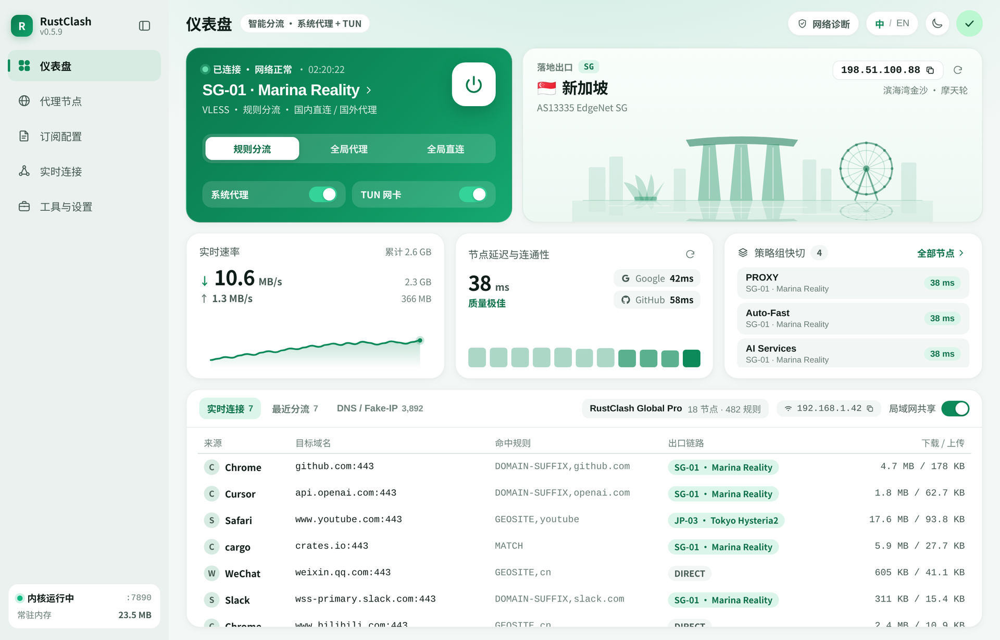
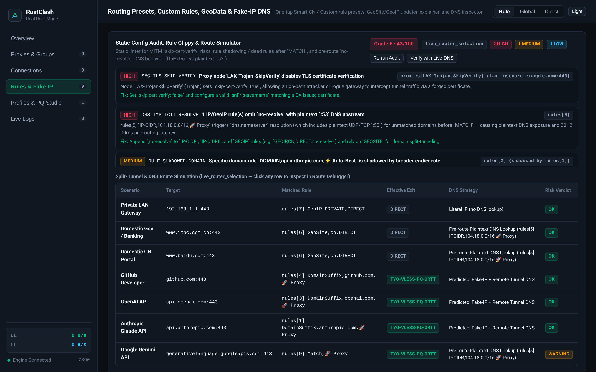
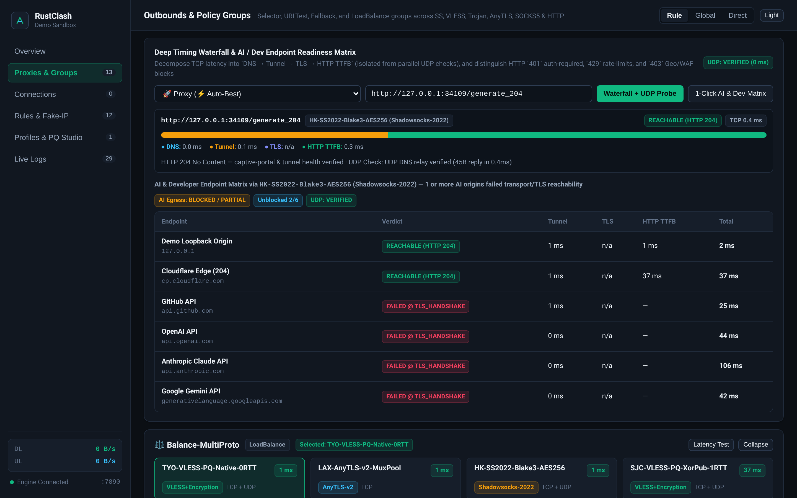

<div align="center">


# RustClash

纯 Rust 编写的多平台代理客户端与用户态 TUN 内核。透明可观测、轻量低占、开源无广告。

**简体中文** · [English](README_en.md)

[](https://github.com/rustclash-labs/rust-clash/releases/latest)
[](https://github.com/rustclash-labs/rust-clash/actions/workflows/ci.yml)
[](crates/proxy-core)
[](#状态与文档)
[](LICENSE-MIT)

[下载](#下载) · [功能](#功能) · [使用](#使用) · [从源码构建](#从源码构建) · [文档](#状态与文档)

</div>

> [!IMPORTANT]
> **全量 AI 编写与审核声明**：本项目从底层纯 Rust 代理内核、用户态 `smoltcp` TUN 协议栈、Tauri 2 桌面端、React Web 控制台到 Android 原生客户端，**全部代码全程由 Gemini Argon 与 Gemini Carbon 编写，并由 GPT 参与代码审核**（人工仅负责需求方向与实机回归指导）。当前处于实验性 Pre-1.0 阶段，尚未经过独立第三方密码学安全审计。

<p align="center">
  
</p>

<details>
<summary>更多界面预览（安全审计 · 全链路耗时瀑布图 · AI 连通矩阵 · MCP）</summary>
<br>
<table>
  <tr>
    <td width="50%" valign="top">
      
      <br><strong>配置安全静态审计</strong> — 自动检测证书跳过风险、DNS 抢先解析泄漏与规则遮蔽。
    </td>
    <td width="50%" valign="top">
      
      <br><strong>全链路耗时瀑布图</strong> — 拆解 <code>DNS → 隧道 → TLS → HTTP 首字节</code> 延迟并验证真实 UDP 转发。
    </td>
  </tr>
  <tr>
    <td width="50%" valign="top">
      
      <br><strong>AI 与开发者接口矩阵</strong> — 一键探测主流 AI / API 端点，精确定位阻塞阶段。
    </td>
    <td width="50%" valign="top">
      
      <br><strong>隐私脱敏 MCP 服务</strong> — 一键接入 AI 编程助手，自动擦除节点密钥与敏感元数据。
    </td>
  </tr>
</table>
</details>

## 功能

- **一套内核覆盖 Android、Windows、macOS 和 Linux**：原生 Jetpack Compose Android 客户端、Tauri 2 桌面客户端、无头 CLI 与内嵌 Web 控制台。
- **100% 纯 Rust 内核与 `smoltcp` 用户态 TUN**：无任何 Go / C 代理边车依赖，桌面端常驻内存仅 `~10–25 MiB`、空闲 CPU `0%`。
- **主流精简协议支持**：支持 **VLESS**（含后量子 `mlkem768x25519plus` 0-RTT/1-RTT）、**Trojan**、**AnyTLS v2**、**Shadowsocks-2022** 与 **SOCKS5 / HTTP(S)**。
- **多传输层国内外分流 DNS**：支持 `Fake-IP` 与真实 IP 模式，内置 `UDP`、`TCP`、`DoT` 与多路复用 `HTTP/2 DoH` 并发竞速及 `Smart CN` 一键分流。
- **白盒化网络诊断**：内置“网站打不开”一键排障医生、`DNS → 隧道 → TLS → HTTP TTFB` 分段耗时瀑布图及真实 UDP 连通性校验。
- **配置安全审计（`Clippy for Clash`）**：静态安全评分（`0–100`）、分流路由模拟与订阅更新安全差异对比。
- **内置隐私脱敏 `MCP` 服务**：支持 Claude Code、Gemini CLI 与 Cursor 直接排查分流与代理异常，默认不暴露任何凭据或节点 IP。
- **平台原生体验**：Android 支持快捷设置磁贴、分应用代理与 Wi-Fi/5G 毫秒级平滑切换；桌面端支持系统托盘与系统密钥链加密存储。

## 下载

从 [`v0.4.12` 最新正式版](https://github.com/rustclash-labs/rust-clash/releases/latest) 获取对应平台安装包（所有构建产物均附带 `SHA256SUMS.txt` 校验文件）。

| 平台 | 安装包 | 说明 |
| --- | --- | --- |
| **Android 8.0 及以上** | `arm64-v8a` 与 `universal` 两种 `.apk` | 绝大多数手机选 `arm64-v8a`，已使用项目持久化发布密钥签名。 |
| **Windows 10 及以上** | 安装版（`.exe` / `.msi`）或 CLI 便携包（`.zip`） | 内置微软签名的 `wintun.dll`；主程序暂未购买商业代码签名证书。 |
| **macOS 13 及以上** | `Apple Silicon` 与 `Intel` 两种 `.dmg` 及 CLI 包 | 未公证签名，首次打开若遇拦截请在访达中右键选择“打开”。 |
| **Linux** | `.deb`、`.rpm` 与 CLI `.tar.gz`（`x64`） | 桌面安装包与 CLI 单文件均已内嵌完整 Web 控制台。 |

## 使用

**命令行快速启动或本地免节点体验**：

```bash
rust-clash run                  # 正常启动（浏览器访问输出的控制面板链接）
rust-clash run --demo           # 本地回环演示沙盒（无需外部节点即可体验全功能）
rust-clash audit -c config.yaml # 静态安全与 DNS 泄漏风险审计
rust-clash probe --matrix       # 全链路分段延迟瀑布图与 UDP 探测
```

**接入 AI 编程助手（`Claude Code` / `Gemini CLI` / `Cursor`）**：

```json
{
  "mcpServers": {
    "rust-clash": {
      "command": "rust-clash",
      "args": ["mcp"]
    }
  }
}
```

## 从源码构建

需要安装最新稳定版 [Rust](https://rustup.rs/)（通过 `rustup`）与 [Node.js](https://nodejs.org/) 22+。

```bash
cd ui && npm ci && npm run build && cd ..
cargo build --locked --release -p proxy-cli                     # 无头 CLI（内嵌 Web UI）
cargo build --locked --release -p tauri-app --features desktop  # 桌面端客户端
./scripts/build_android.sh                                      # Android APK 与 AAB
```

| 平台 | 额外编译依赖 |
| --- | --- |
| **Android** | JDK 17+、Android SDK（`API 35+`）与 Android NDK。 |
| **Windows** | MSVC 生成工具与 WebView2 运行时（Windows 11 已自带）。 |
| **macOS** | Xcode Command Line Tools。 |
| **Linux** | WebKitGTK 4.1 与 GTK 3 开发头文件（仅构建 `tauri-app` 桌面端时需要）。 |

## 状态与文档

- **协议范围说明**：为保持纯 Rust 实现的精简与可维护性，未实现 `VMess`、`Hysteria2`、`TUIC`、VLESS `REALITY` 等历史/扩展协议（导入混合订阅时会自动跳过不支持的节点）。
- **延伸阅读**：[跨平台与 TUN 状态](docs/PLATFORM_SUPPORT.md) · [Android 架构说明](docs/ANDROID_IMPLEMENTATION.md) · [性能基准报告](docs/PERFORMANCE_BENCHMARK.md) · [安全策略](SECURITY.md) · [贡献指南](CONTRIBUTING.md)

## 许可证

采用 [MIT](LICENSE-MIT) 或 [Apache-2.0](LICENSE-APACHE) 双许可证发布；第三方开源组件声明（含 Windows 版随附的 `wintun.dll`）详见 [THIRD_PARTY_NOTICES.md](THIRD_PARTY_NOTICES.md)。
