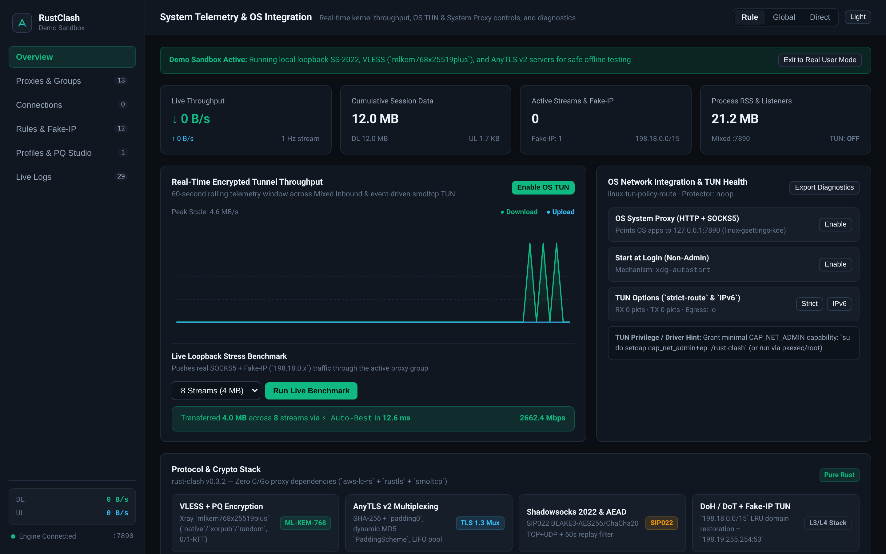
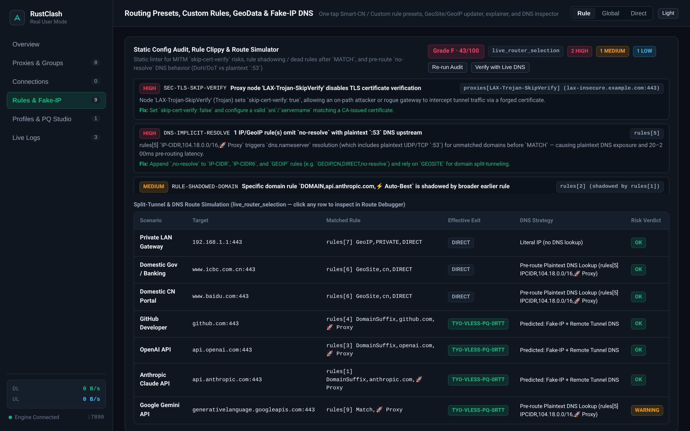
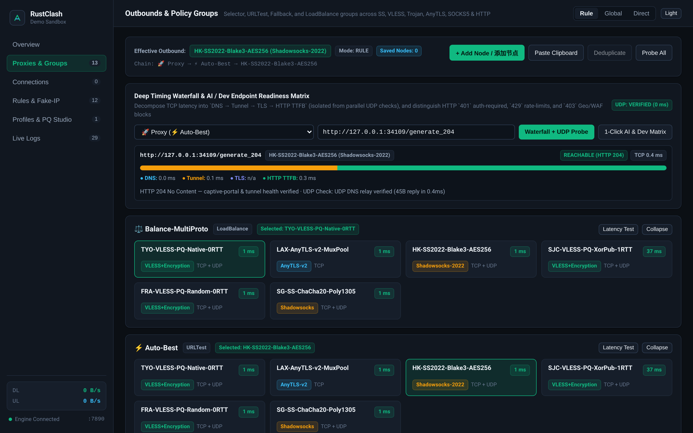
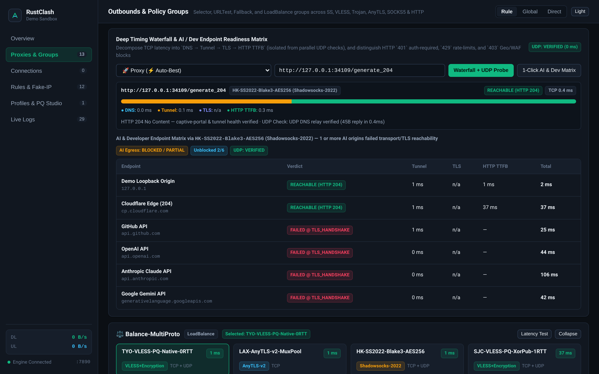
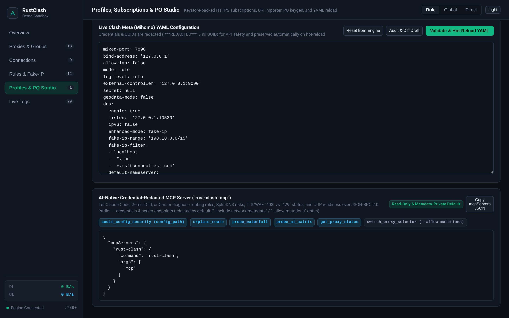

<div align="center">

# RustClash (`rust-clash`)

**Glass-box pure-Rust proxy engine, userspace TUN stack, and cross-platform client — built-in static config security audit (`Clippy for Clash`), per-stage timing waterfall diagnostics, and credential-redacted `MCP` integration.**

纯 Rust 编写的透明可观测代理内核与跨平台客户端 —— 内置配置安全静态审计、全链路耗时瀑布图诊断与隐私脱敏 `MCP` 服务（无 Go / C 代理边车依赖）。

[](https://github.com/rustclash-labs/rust-clash/actions/workflows/ci.yml)
[](https://github.com/rustclash-labs/rust-clash/releases/latest)
[](LICENSE-MIT)
[-f59e0b)](crates/proxy-core)
[](#platform-compatibility--verification-status)

[**Screenshots**](#product-screenshots) · [**Why RustClash?**](#why-rustclash) · [**Download & Quick Start**](#download--quick-start) · [**Compatibility & Experimental Notice**](#platform-compatibility--verification-status) · [**Architecture & Protocols**](#architecture--implemented-capabilities) · [**Benchmarks**](#single-host-loopback-benchmark-summary-v020-linux-x86_64-n--6-rounds) · [**Docs**](#documentation-security--contributing)

</div>

---

`rust-clash` combines a pure-Rust proxy kernel (`crates/proxy-core`), CLI daemon (`crates/proxy-cli`), Tauri 2 desktop client (`crates/tauri-app`), JNI/C-ABI bridge (`crates/proxy-ffi`), Jetpack Compose Android `VpnService` app (`android/`), and embedded React 19 Web Console (`ui/`) — supporting **VLESS (`mlkem768x25519plus` Post-Quantum 0-RTT/1-RTT)**, **Trojan**, **AnyTLS v2**, **Shadowsocks-2022 (`SIP022`)**, **SOCKS5 / HTTP(S)**, **Multi-Transport Fake-IP DNS**, and **event-driven `smoltcp` Userspace TUN** without Go (`mihomo`/`sing-box`/`xray-core`) or C/C++ proxy sidecars.

> [!IMPORTANT]
> **Experimental & AI-Authored Prototype (`v0.3.2`, Pre-1.0)**: Written end-to-end by **Gemini 4 Argon** and **Gemini 4 Carbon** under human direction and review; **not** independently security-audited. Linux (`ip netns` `/dev/net/tun`) and localhost external protocol interop run in automated CI, while physical Windows, macOS, and Android TUN/VPN hardware UAT and desktop code-signing remain pending — see [**Platform Compatibility & Verification Status**](#platform-compatibility--verification-status) before use.

---

## Product Screenshots

> All screenshots below are captured directly from the live `rust-clash v0.3.2` daemon and embedded Web Console using the built-in `--demo` local loopback sandbox and synthetic RFC 2606 (`*.example.com`) configurations — zero mockups and zero real server credentials.

### Dashboard, Real-Time Encrypted Throughput & OS Integration



*Live `Overview` console in `--demo` mode driving 8 parallel encrypted streams across local loopback `VLESS + ML-KEM-768`, `AnyTLS v2`, and `Shadowsocks-2022` servers (`~21.2 MB` RSS, embedded Web UI).*

### Glass-Box Security Audit, Timing Waterfall, AI Matrix & `MCP` Studio

<table>
  <tr>
    <td width="50%" valign="top">
      <a href="docs/images/config-security-audit.png">
        
      </a>
      <br />
      <strong>1. Config Security Audit (<code>Clippy for Clash</code>)</strong> — Static linter catching <code>skip-cert-verify: true</code> MITM risks, missing <code>no-resolve</code> pre-route DNS leaks, and shadowed rules alongside the Split-DNS route simulator (synthetic <code>*.example.com</code> profile).
    </td>
    <td width="50%" valign="top">
      <a href="docs/images/timing-waterfall.png">
        
      </a>
      <br />
      <strong>2. Per-Stage Timing Waterfall + UDP Verification</strong> — Decomposes latency into <code>DNS → Tunnel → TLS → HTTP TTFB</code> alongside parallel RFC 1035 UDP relay verification and multi-protocol policy groups.
    </td>
  </tr>
  <tr>
    <td width="50%" valign="top">
      <a href="docs/images/ai-endpoint-matrix.png">
        
      </a>
      <br />
      <strong>3. AI &amp; Developer Endpoint Readiness Matrix</strong> — 1-click probe across gateway/API origins with stage-isolated failure pinpointing (captured inside an isolated cloud CI sandbox where loopback/HTTP succeed and sandboxed <code>:443</code> surfaces <code>FAILED @ TLS_HANDSHAKE</code>).
    </td>
    <td width="50%" valign="top">
      <a href="docs/images/mcp-integration.png">
        
      </a>
      <br />
      <strong>4. Credential-Redacted <code>MCP</code> &amp; YAML Studio</strong> — Ready-to-copy <code>rust-clash mcp</code> config for Claude Code, Gemini CLI, and Cursor, paired with automatic secret/UUID redaction in live YAML views.
    </td>
  </tr>
</table>

*Desktop & Mobile UI note: `rust-clash-desktop` (Tauri 2) renders this same embedded Web Console inside a native OS window with System Tray controls, while the Android client (`android/`) pairs a native Jetpack Compose Material 3 `VpnService` UI with the embedded console.*

---

## Why RustClash?

Instead of competing purely on legacy protocol sprawl, `rust-clash` targets three everyday pain points across mainstream proxy clients (`Mihomo`, `Clash Verge Rev`, `sing-box`, `v2rayN`): opaque `generate_204` latency numbers, silent subscription security/DNS pitfalls, and manual black-box debugging when AI or developer tools fail behind a proxy.

### 1. Config Security Audit (`Clippy for Clash` — `rust-clash audit` & `/diagnostics/audit`)
- **Static Security & Rule Linter (`0–100` Score, Grade `A`–`F`)**: Flags MITM-vulnerable `skip-cert-verify: true` nodes, unencrypted remote transports, unauthenticated LAN controllers, shadowed domain/CIDR rules, dead rules after `MATCH`, and `IP-CIDR`/`GEOIP` rules missing `no-resolve` (distinguishing encrypted DoH/DoT pre-route lookups from plaintext `:53` ISP DNS exposure).
- **Split-DNS Route Simulator & Subscription Diffs**: Separates offline `static_first_member_estimate` previews from live `Router` selector/URLTest state (`live_router_selection`) and optional live DNS resolution (`?resolve_dns=true`), plus **credential-redacted Subscription Refresh Security Diffs** that warn before newly insecure upstream nodes go unnoticed.

### 2. Network Diagnostic Timing Waterfall (`rust-clash probe` & `/proxies/{name}/probe` · `/matrix`)
- **Stage-Exact Latency Decomposition**: Breaks TCP connection health into `DNS Resolve → Tunnel Connect → TLS Handshake [TLSv1.3 / ALPN] → HTTP TTFB` (isolated from parallel UDP checks so slow or blackholed UDP probes never inflate TCP latency history).
- **Actionable HTTP & UDP Verdicts**: Distinguishes `Reachable` (`2xx`/`3xx`), `AuthRequired` (`401` unblocked API gateway), `RateLimited` (`429` shared-IP quota/throttle — never misreported as API-ready), and `BlockedOrChallenged` (`403`/`451` Geo/WAF blocks); verifies **real UDP datagram relay** (`verified` vs `blackholed` vs `unsupported`) via RFC 1035 DNS echo; and enforces a built-in **SSRF / private-network guard** (blocking loopback, RFC1918 LAN, link-local `169.254.0.0/16`, and cloud metadata endpoints by default).

### 3. AI / `MCP` Integration (`rust-clash mcp`)
- **Zero-Config JSON-RPC 2.0 `stdio` MCP Server**: Exposes `audit_config_security`, `explain_route`, `probe_waterfall`, `probe_ai_matrix`, and `get_proxy_status` (plus opt-in `switch_proxy_selector` behind `--allow-mutations`) so **Claude Code**, **Gemini CLI**, or **Cursor** can diagnose routing mismatches, Split-DNS leaks, and `403`/`429` API errors directly.
- **Privacy & Secret Redaction by Default**: Unconditionally scrubs passwords, UUIDs, private keys, and Bearer tokens; rejects raw YAML secret payloads in tool arguments (auditing local files via `config_path` instead); and defaults to **metadata-privacy mode** (redacting proxy server IPs/domains and destination hosts unless `--include-network-metadata` is explicitly enabled).

---

## Download & Quick Start

### Prebuilt Releases ([`v0.3.2` Latest Release](https://github.com/rustclash-labs/rust-clash/releases/latest))

Every release publishes [`SHA256SUMS.txt`](https://github.com/rustclash-labs/rust-clash/releases/latest) across all 14 desktop, CLI, and mobile artifacts:

| Platform | Desktop / Mobile App | Headless CLI (`rust-clash`) | Notes |
|---|---|---|---|
| **Linux (`x86_64`)** | `RustClash_0.3.2_amd64.deb`<br/>`RustClash-0.3.2-1.x86_64.rpm` | `rust-clash-cli-linux-x86_64.tar.gz` | Embedded Web UI included in both CLI & Tauri desktop packages |
| **Windows 10/11 (`x86_64`)** | `RustClash_0.3.2_x64-setup.exe`<br/>`RustClash_0.3.2_x64_en-US.msi` | `rust-clash-cli-windows-x86_64.zip` | Unsigned installer (SmartScreen prompt); bundled `wintun.dll` retains Microsoft/WireGuard LLC signature |
| **macOS 13+ (`arm64` / `x64`)** | `RustClash_0.3.2_aarch64.dmg`<br/>`RustClash_0.3.2_x64.dmg` | `rust-clash-cli-macos-arm64.tar.gz`<br/>`rust-clash-cli-macos-x86_64.tar.gz` | Unsigned `.dmg` (Gatekeeper prompt); physical macOS TUN pending UAT |
| **Android 8.0+ (`API 26+`)** | `rust-clash-android-arm64-v8a.apk`<br/>`rust-clash-android-universal.apk` | — *(JNI `libproxy_ffi.so` bundled)* | Signed with project release keystore (`x86_64` APK & `.aab` also attached) |

### 60-Second Demo Sandbox & CLI Quick Start

Launch the self-contained local loopback cluster (no external servers or subscriptions needed) and open **`http://127.0.0.1:9090`**:

```bash
# 1. Start the local multi-protocol Demo Sandbox (VLESS+PQ 0-RTT/1-RTT, AnyTLS v2 & SS-2022 on 127.0.0.1)
rust-clash run --demo \
  --mixed-port 7890 \
  --controller 127.0.0.1:9090 \
  --dns-listen 127.0.0.1:1053

# 2. Or launch in Real User Mode (creates an empty local Starter Profile with zero third-party nodes)
rust-clash run

# 3. Validate config syntax & run `Clippy for Clash` static security + Split-DNS audit
rust-clash check -c configs/clash-demo.yaml
rust-clash audit -c configs/clash-demo.yaml

# 4. Run per-stage timing waterfall (`DNS -> Tunnel -> TLS -> HTTP TTFB`) + UDP probe or full AI matrix
#    (loopback/private targets are blocked by default; pass `--allow-private-targets` for local lab testing)
rust-clash probe --url https://api.github.com/
rust-clash probe --matrix

# 5. Check OS System TUN driver, privilege & crash-recovery preflight status
rust-clash tun-check

# 6. Generate Xray-compatible Post-Quantum VLESS (`mlkem768x25519plus`) keypairs
rust-clash keygen-vless --mode xorpub
```

#### Connect AI Coding Agents via `MCP` (`Claude Code` / `Gemini CLI` / `Cursor`)

```json
{
  "mcpServers": {
    "rust-clash": {
      "command": "rust-clash",
      "args": ["mcp"]
    }
  }
}
```

*(Read-only and metadata-private by default; append `"--include-network-metadata"` or `"--allow-mutations"` to `args` only when explicitly needed.)*

---

## Platform Compatibility & Verification Status

> **Experimental & AI-Authored Notice / 实验性项目与 AI 编写声明**
> - **AI-Authored Prototype**: This codebase is **experimental** in nature and was written end-to-end by **Gemini 4 Argon** and **Gemini 4 Carbon** under human direction and review. It has **not** undergone an independent third-party cryptographic or security audit. Do not rely on it for high-stakes anonymity or production workloads.
> - **Verification & Signing Scope**: Only Linux (`ip netns` `/dev/net/tun` + policy routing) and localhost (`127.0.0.1`) protocol interoperability are executed end-to-end in automated CI today. Live privileged TUN/VPN packet capture on **physical Windows, macOS, and Android devices** has not yet undergone hardware UAT sign-off, and Windows/macOS desktop installers are currently unsigned. Review the matrix below before use.
> - **中文说明**：本项目为**实验性质**的纯 Rust 跨平台代理客户端原型，代码全程由 **Gemini 4 Argon** 与 **Gemini 4 Carbon** 编写，尚未经过独立第三方密码学或安全审计，且 Windows / macOS / Android 真机系统级 TUN 仍待实机验收，仅供技术研究、学习与受控环境测试使用。

| Platform / Subsystem | Build & CI Automated Coverage | Live OS / Physical Hardware Status | Signing & Distribution Notes |
|---|---|---|---|
| **Linux (`x86_64`)** | Unit/E2E suite, Tauri 2 WebKitGTK build, and isolated `ip netns` `/dev/net/tun` + `SO_MARK` policy routing E2E (`scripts/ci_linux_netns_tun_test.sh`) | **Live-tested in Linux kernel network namespaces** | `.tar.gz`, `.deb`, `.rpm` (unsigned packages; `SHA256SUMS.txt` published) |
| **Windows 10/11 (`x86_64`)** | Rust unit/E2E suite, `wintun.dll` SHA-256 verification, CLI `.zip` & Tauri `.exe`/`.msi` packaging | **`NOT TESTED` on a live Administrator Windows host** (`wintun.dll` ring I/O, `iphlpapi` split routes & roaming recovery implemented, pending live host UAT) | Executable/installers are **not Authenticode-signed** (SmartScreen warning); bundled `wintun.dll` retains upstream Microsoft/WireGuard LLC driver signature |
| **macOS 13+ (`arm64` / `x86_64`)** | Rust unit/E2E suite, CLI `.tar.gz` & Tauri `.dmg` packaging, Swift `NEPacketTunnelProvider` (`platforms/macos-ne/`) `swiftc -typecheck` | **`NOT TESTED` on physical macOS hardware** (`PF_SYSTEM` `utun` & `scutil` DNS/route code pending root UAT; `.systemextension` blocked by macOS without paid entitlement) | `.dmg` is **not signed/notarized** with Apple Developer ID; `NEPacketTunnelProvider` requires a paid Apple Developer `networkextension` entitlement |
| **Android 8.0+ (`API 26+`)** | Cross-compiled `libproxy_ffi.so` (`arm64-v8a`, `x86_64`), Kotlin JUnit + Robolectric UI tests, Android Lint, R8 APK/AAB assembly | **`NOT TESTED` on a physical Android handset or emulator VPN tunnel** (`VpnService`, `protect(fd)`, Per-App VPN & network handoff implemented, pending device UAT per [`docs/USER_ACCEPTANCE_TESTS.md`](docs/USER_ACCEPTANCE_TESTS.md)) | Release APKs (`v1+v2+v3`) signed with project self-signed release keystore (`SHA256SUMS.txt` published) |
| **External Protocol Interop** | Bidirectional TCP + UDP tests against official `XTLS/Xray-core v26.10.31`, `shadowsocks-rust v1.25.0`, and `anytls-go v0.0.13` (`interop_external_e2e.rs`) | **Verified over local loopback (`127.0.0.1`) in CI** (not benchmarked or soaked across multi-hop WAN/CDN paths) | Reference binaries fetched & SHA-256 checked in CI `/tmp` only; never bundled |

---

## Architecture & Implemented Capabilities

### 1. System TUN Backends & Userspace `smoltcp` Stack
- **Linux (`/dev/net/tun` + Policy Routing + `SO_MARK`)**: Dynamic policy routing table selection, owned-rule ledger (avoids flushing unrelated host tables), IPv4/IPv6 capture, and `SO_MARK` (`fwmark`) outbound loop prevention.
- **Windows (`wintun.dll` + `iphlpapi`)**: Dynamic loading of unmodified `wintun.dll` (`LoadLibraryExW` safe search flags), ring-buffer packet I/O, `CreateUnicastIpAddressEntry` IPv4/IPv6 + `0.0.0.0/1` & `128.0.0.0/1` split-tunnel routes, `IP_UNICAST_IF` physical NIC binding, and `NotifyIpInterfaceChange` callbacks *(pending live Windows UAT)*.
- **macOS (`PF_SYSTEM` `utun` + Swift `NEPacketTunnelProvider` source)**: Darwin `com.apple.net.utun_control` socket framing, `IP_BOUND_IF` primary interface binding, `scutil`/`networksetup` DNS & route snapshot/restore, plus Swift `NEPacketTunnelProvider` bridge source under `platforms/macos-ne/` *(pending physical macOS UAT & Apple Developer signing)*.
- **Android (`VpnService` + Jetpack Compose + Quick Settings `TileService` + `crates/proxy-ffi` JNI)**: Kotlin Material 3 client (`android/`) bridging `ParcelFileDescriptor` TUN FDs into `smoltcp`, invoking `VpnService.protect(fd)` on outbound TCP/UDP/DNS bootstrap sockets, with Per-App allowlist/denylist and `ConnectivityManager` callbacks *(pending physical handset UAT)*.
- **Event-Driven Userspace Stack (`smoltcp` `AnyIP`)**: `iface.poll_delay()` timer scheduling, IPv4/IPv6 TCP stream reassembly, stateful `UdpNatManager` UDP sessions, and `any:53` DNS interception.

### 2. Supported Outbound Protocols & Compatibility Boundaries
- **VLESS (`v0`) + Post-Quantum Encryption (`mlkem768x25519plus`) + WebSocket (`WS` / `WSS` + `0-RTT`)**:
  - Loopback-verified against **`XTLS/Xray-core v26.10.31`**; supports `native`, `xorpub`, and `random` header modes, **1-RTT** (`X25519` + `ML-KEM-768`) & **0-RTT** ticket resumption, VLESS UDP (`0x02`) & XUDP (`0x03`), WebSocket `max-early-data`, and `rust-clash keygen-vless`.
- **Trojan (`TCP+TLS` & `WS+TLS` + UDP Relay)**:
  - SHA-224 hex credential framing with initial payload coalescing, native Trojan UDP framing, TLS session resumption, WebSocket `0-RTT` early-data transport, and `trojan://` URI import/export *(verified via internal loopback E2E tests)*.
- **AnyTLS v2 + UoT v2**:
  - Loopback-verified against **`anytls-go v0.0.13`**; TLS 1.3 (`tokio-rustls` + `aws-lc-rs`), SHA-256 + `padding0` authentication, configurable `PaddingScheme`, LIFO `SessionPool` multiplexing, and UDP-over-TCP v2 (`sp.v2.udp-over-tcp.arpa`).
- **Shadowsocks Legacy AEAD & Shadowsocks-2022 (`SIP022`)**:
  - Loopback-verified against **`shadowsocks-rust v1.25.0`**; `aes-128-gcm`, `aes-256-gcm`, `chacha20-ietf-poly1305`, `2022-blake3-aes-128-gcm`, `2022-blake3-aes-256-gcm`, and `2022-blake3-chacha20-poly1305` (TCP + stateful SIP022 UDP + 60s replay window).
- **SOCKS5 (`RFC 1928/1929` TCP + `UDP ASSOCIATE` + Optional TLS) & HTTP/HTTPS `CONNECT`**:
  - Supports `socks5://`, `socks5h://`, `http-proxy://`, and `https-proxy://` URIs and Clash YAML entries.
- **Explicitly Unsupported Clash Meta Protocols**:
  - `VMess`, `Hysteria2`, `TUIC`, `WireGuard` outbound, VLESS `REALITY` / XTLS `flow` (`xtls-rprx-vision`), and `gRPC` / `HTTPUpgrade` transports are **not** implemented. Mixed V2Board/Mihomo subscriptions containing unsupported node types automatically skip those entries and prune group references (`SkippedProxyEntry`) when at least one supported node is present.

### 3. Multi-Transport DNS, Routing Engine & Profile Management
- **Multi-Transport DNS Engine**: `UDP`, `TCP`, **DNS-over-TLS (`tls://`)**, and **DNS-over-HTTPS (`https://` RFC 8484)** with pooled connections, `singleflight` query deduplication, literal-IP `default-nameserver` bootstrap separation, `fake-ip` (`198.18.0.0/15`) & `redir-host`/`normal` modes, negative caching, and TTL clamping.
- **RFC 8305 Happy Eyeballs & TLS Resumption**: Interleaved IPv6/IPv4 connection racing (`250 ms` stagger) integrated with engine DNS + `SocketProtector` and `rustls` `ClientSessionMemoryCache(256)`.
- **Routing Engine**: Hash/radix domain matching, binary-search interval tables for `IP-CIDR` / `IP-CIDR6` / `SRC-IP-CIDR` / `RULE-SET` (`rule-providers`), built-in fallback + optional `.mmdb` / remote rule-list `GEOIP` & `GEOSITE`, `PROCESS-NAME` matching, and `/rules/explain` diagnostics.
- **Profiles & Credential Hygiene**: Persistent HTTPS subscription manager (`Subscription-Userinfo`, V2Board/Mihomo YAML normalization, atomic `.bak` rollback), OS `SecretVault` integration (Windows DPAPI, macOS Keychain, Linux Secret Service, Android Keystore, with `0600` local AES-256-GCM fallback in headless environments), `RecoveryJournal` crash rollback, and automatic credential redaction in `GET /configs` and `GET /diagnostics/export`.

---

## Single-Host Loopback Benchmark Summary (`v0.2.0`, Linux `x86_64`, `n = 6` Rounds)

> **Benchmark Scope & Caveats**: Measurements below were recorded on **`rust-clash v0.2.0`** across 6 interleaved Latin-square rounds on a **single Linux `x86_64` cloud VM (`Intel Xeon Platinum 8481C`, 2 vCPUs)** over **kernel loopback (`127.0.0.1`)** against a local `shadowsocks-rust v1.25.0` server (`2022-blake3-aes-256-gcm`). Client, proxy, upstream server, and echo origin shared the same 2-vCPU host; results measure userspace CPU/memory overhead and loopback scheduling rather than physical NIC, WAN packet-loss, or mobile hardware performance. Notice that `sing-box` leads single-stream TCP bulk throughput on loopback, while 8-stream TCP multi-stream 95% confidence intervals overlap across all three engines. Full methodology, CIs, and raw data are in [`docs/PERFORMANCE_BENCHMARK.md`](docs/PERFORMANCE_BENCHMARK.md).

| Metric (`n = 6` interleaved rounds, `Mean ± SD` / `Median`) | `rust-clash v0.2.0` (Mixed) | `mihomo v1.19.33` (Mixed) | `sing-box v1.14.4` (Mixed) | `rust-clash v0.2.0` (`L3 TUN MTU 1500`) |
|---|---:|---:|---:|---:|
| **Binary Size** | `20.02 MiB` *(incl. Web UI)* | `59.20 MiB` | `77.64 MiB` | `20.02 MiB` |
| **Cold Startup Ready (ms)** | `22.87 ± 12.37` (`21.00`) | `25.64 ± 6.89` (`21.44`) | `43.51 ± 4.19` (`41.91`) | — |
| **Idle CPU (%)** | `0.00 ± 0.00 %` | `0.17 ± 0.26 %` (`0.00 %`) | `0.00 ± 0.00 %` | `0.00 %` *(event-driven)* |
| **Idle / Peak `VmRSS` (MiB)** | `9.63 ± 0.20` / `13.80 ± 0.28` | `39.49 ± 0.93` / `60.76 ± 1.11` | `54.35 ± 0.53` / `56.73 ± 0.52` | `9.46 ± 0.13` / `24.34 ± 0.45` |
| **TCP Single-Stream 64 MiB (Mbps)** | `2,690 ± 148` (`2,704`) | `2,630 ± 78` (`2,621`) | `4,536 ± 231` (`4,606`) | `2,175 ± 225` (`2,243`, 16 MiB) |
| **TCP Multi-Stream (Mbps)** | `5,347 ± 1,305` (`5,833`, 8-str) | `5,429 ± 511` (`5,381`, 8-str) | `6,078 ± 287` (`6,037`, 8-str) | `2,622 ± 143` (`2,600`, 4-str) |
| **Encrypted Echo RTT `P50` (ms)** | `0.194 ± 0.042` (`0.178`) | `0.339 ± 0.020` (`0.333`) | `0.274 ± 0.023` (`0.269`) | `0.344 ± 0.023` (`0.343`) |
| **UDP Relay (`loss` / `PPS`)** | `0.0%` / `11,630 ± 1,407` | `0.0%` / `10,200 ± 427` | `0.0%` / `12,642 ± 930` | `0.0%` / `8,036 ± 573` |
| **DNS / Hijack `P50` (ms)** | `0.026 ± 0.001` (`26 µs`) | `0.046 ± 0.002` (`45 µs`) | `0.049 ± 0.005` (`48 µs`) | `0.033 ± 0.009` (`36 µs`) |

---

## Workspace Layout & Build from Source

```text
rust-clash/
├── crates/
│   ├── proxy-core/        # Pure-Rust proxy kernel, protocols, DNS, router, TUN, profiles & REST/WS API
│   ├── proxy-ffi/         # JNI & C-ABI mobile/extension bridge (Android VpnService + macOS NE)
│   ├── proxy-cli/         # `rust-clash` CLI daemon, TUN helper, config validator & protocol servers
│   └── tauri-app/         # `rust-clash-desktop` Tauri 2 native shell, System Tray & IPC commands
├── android/               # Native Kotlin Android VpnService client, Per-App VPN UI & Gradle project
├── platforms/macos-ne/    # Swift NEPacketTunnelProvider & C FFI header source for macOS
├── ui/                    # Responsive Desktop & Mobile React 19 + TypeScript + Vite 6 Console
├── configs/               # Synthetic RFC 2606 example configuration (`clash-demo.yaml`)
├── scripts/               # Android NDK build, Wintun verifier, Linux netns E2E & benchmark scripts
└── docs/                  # Architecture, platform support, security, benchmark, UAT reports & UI screenshots (`images/`)
```

```bash
# 1. Build embedded React 19 Web Console
cd ui && npm ci && npm run build && cd ..

# 2. Build Headless CLI & Embedded Web Console (`rust-clash`)
cargo build --locked --release -p proxy-cli

# 3. Build Tauri 2 Desktop App (Windows WebView2 / macOS WKWebView / Linux WebKitGTK)
cargo build --locked --release -p tauri-app --features desktop

# 4. Cross-compile Rust JNI (`arm64-v8a` + `x86_64`), run JUnit tests, and assemble Android APK & AAB
./scripts/build_android.sh
```

---

## Documentation, Security & Contributing

### Governance & Vulnerability Reporting
- **Maintainer**: **RustClash Labs** (`https://github.com/rustclash-labs/rust-clash` · [`rustclash.labs@proton.me`](mailto:rustclash.labs@proton.me))
- [**Security Policy & Private Vulnerability Reporting (`SECURITY.md`)**](SECURITY.md) — **Never** post real subscription URLs, server IPs, node passwords/UUIDs, or undisclosed vulnerabilities in public GitHub Issues.
- [**Contributing & Sanitization Guidelines (`CONTRIBUTING.md`)**](CONTRIBUTING.md)
- [**Third-Party Licenses & Attribution Notices (`THIRD_PARTY_NOTICES.md`)**](THIRD_PARTY_NOTICES.md)

### Engineering Reports (`docs/`)
1. [**Cross-Platform System TUN & OS Verification Matrix**](docs/PLATFORM_SUPPORT.md)
2. [**Native Android VpnService & JNI Architecture**](docs/ANDROID_IMPLEMENTATION.md)
3. [**Security Review & Threat Model**](docs/SECURITY_REVIEW.md)
4. [**Comparative Loopback Benchmarks (`rust-clash` vs `Mihomo` vs `sing-box`)**](docs/PERFORMANCE_BENCHMARK.md)
5. [**Test & Interoperability Verification Matrix**](docs/TEST_REPORT.md)
6. [**Remaining Issues, Signing & Physical-Hardware UAT Blockers**](docs/REMAINING_ISSUES.md)
7. [**Physical Device User Acceptance Test Guide**](docs/USER_ACCEPTANCE_TESTS.md)
8. [**Engineering Plan & Milestone Ledger**](docs/ULTIMATE_PLAN.md)

---

## License

Dual-licensed under either the [**MIT License**](LICENSE-MIT) or the [**Apache License, Version 2.0**](LICENSE-APACHE), at your option.

Windows release archives include unmodified `wintun.dll` (`v0.14.1`) alongside `wintun-LICENSE.txt` under the WireGuard LLC Prebuilt Binaries License; see [`THIRD_PARTY_NOTICES.md`](THIRD_PARTY_NOTICES.md) for complete third-party license notices and trademark disclaimers.
