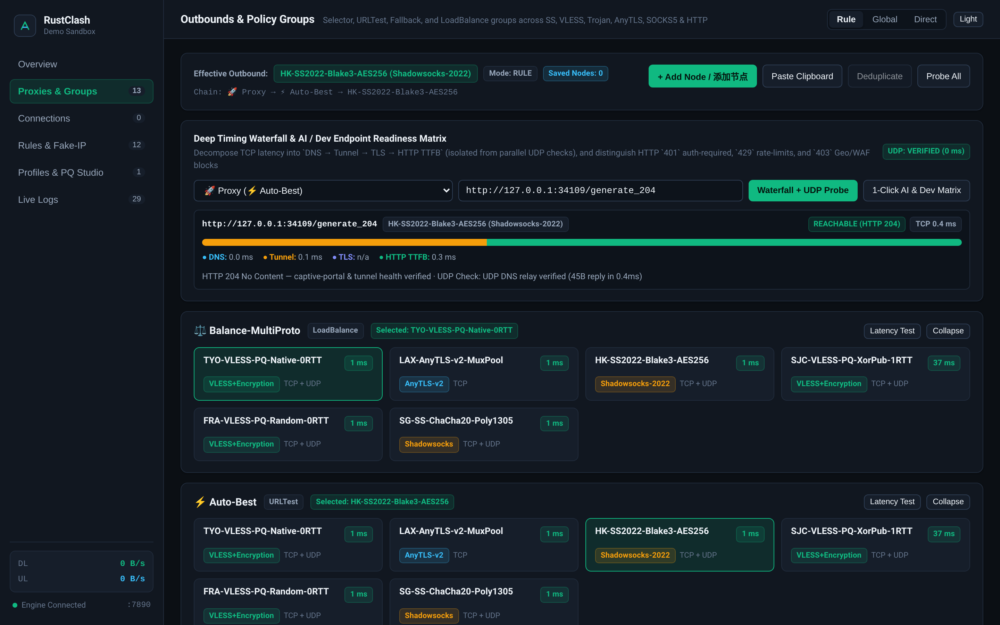
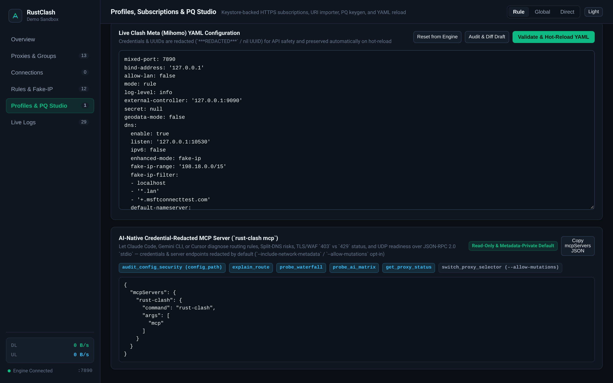

<div align="center">


# RustClash

A pure-Rust multi-platform proxy client and userspace TUN engine. Transparent, lightweight, open-source and ad-free.

**English** · [简体中文](README_zh_CN.md)

[](https://github.com/rustclash-labs/rust-clash/releases/latest)
[](https://github.com/rustclash-labs/rust-clash/actions/workflows/ci.yml)
[](crates/proxy-core)
[](LICENSE-MIT)

[Download](#download) · [Features](#features) · [Usage](#usage) · [Build from source](#build-from-source) · [Docs](#status--docs)

</div>

<p align="center">
  
</p>

<details>
<summary>More screenshots (Security Audit · Timing Waterfall · AI Matrix · MCP)</summary>
<br>
<table>
  <tr>
    <td width="50%" valign="top">
      
      <br><strong>Config Security Audit</strong> — Static linter catching MITM risks, DNS leaks, and shadowed rules.
    </td>
    <td width="50%" valign="top">
      
      <br><strong>Timing Waterfall</strong> — Breaks latency into <code>DNS → Tunnel → TLS → HTTP TTFB</code> plus UDP check.
    </td>
  </tr>
  <tr>
    <td width="50%" valign="top">
      
      <br><strong>AI &amp; Dev Readiness Matrix</strong> — 1-click stage-isolated probe across common AI and API endpoints.
    </td>
    <td width="50%" valign="top">
      
      <br><strong>Privacy-First MCP Studio</strong> — Ready-to-copy <code>MCP</code> config and credential-redacted YAML view.
    </td>
  </tr>
</table>
</details>

## Features

- **One client across Android, Windows, macOS, and Linux** — native Jetpack Compose Android app, Tauri 2 desktop app, headless CLI, and embedded Web UI.
- **100% pure-Rust core & userspace `smoltcp` TUN** — zero Go or C/C++ proxy sidecars (`~10–25 MiB` desktop RSS, `0%` idle CPU).
- **Modern outbound protocols** — **VLESS** (with Post-Quantum `mlkem768x25519plus` 0-RTT/1-RTT), **Trojan**, **AnyTLS v2**, **Shadowsocks-2022**, and **SOCKS5 / HTTP(S)**.
- **Multi-transport Split-DNS** — `Fake-IP` and Real-IP modes over `UDP`, `TCP`, `DoT`, and multiplexed `HTTP/2 DoH` with hedged failover and `Smart CN` routing.
- **Glass-box diagnostics** — plain-language Site Connectivity Doctor, `DNS → Tunnel → TLS → HTTP TTFB` waterfall probes, and real UDP relay verification.
- **`Clippy for Clash` security audit** — built-in static config linter (`0–100` score), Split-DNS route simulator, and subscription refresh diffing.
- **Credential-redacted `MCP` server** — lets Claude Code, Gemini CLI, and Cursor inspect routing and connectivity without exposing node secrets.
- **Platform touches** — Android Quick Settings tile, per-app VPN, and fast Wi-Fi/5G handoff; desktop system tray and OS keychain storage.

## Download

Get the latest build from [`v0.4.12` Latest Release](https://github.com/rustclash-labs/rust-clash/releases/latest) (all artifacts ship with `SHA256SUMS.txt`).

| Platform | Packages | Notes |
| --- | --- | --- |
| **Android 8.0+** | `arm64-v8a` and `universal` `.apk` | Most phones use `arm64-v8a`. Signed with the project release key. |
| **Windows 10+** | `.exe` installer, `.msi`, or CLI `.zip` (`x64`) | Includes signed `wintun.dll`; installer itself is currently unsigned. |
| **macOS 13+** | `.dmg` and CLI `.tar.gz` (`Apple Silicon` & `Intel`) | Unsigned `.dmg` (requires right-click Open on first launch). |
| **Linux** | `.deb`, `.rpm`, and CLI `.tar.gz` (`x64`) | Embedded Web UI included in both desktop and CLI builds. |

## Usage

**Run from CLI or try the local Demo Sandbox** (no external servers required):

```bash
rust-clash run                  # Normal mode (web console on 127.0.0.1:9090)
rust-clash run --demo           # Local loopback sandbox (VLESS+PQ, AnyTLS v2, SS-2022)
rust-clash audit -c config.yaml # Static security & Split-DNS leak check
rust-clash probe --matrix       # Stage-by-stage timing waterfall & UDP check
```

**Connect AI coding agents via `MCP`** (`Claude Code` / `Gemini CLI` / `Cursor`):

```json
{
  "mcpServers": {
    "rust-clash": {
      "command": "rust-clash",
      "args": ["mcp"]
    }
  }
}
```

## Build from source

Requires [Rust](https://rustup.rs/) (stable) and [Node.js](https://nodejs.org/) 22+.

```bash
cd ui && npm ci && npm run build && cd ..
cargo build --locked --release -p proxy-cli                     # Headless CLI + Web UI
cargo build --locked --release -p tauri-app --features desktop  # Desktop client
./scripts/build_android.sh                                      # Android APK & AAB
```

| Platform | Extra prerequisites |
| --- | --- |
| **Android** | JDK 17+, Android SDK (`API 35+`), and Android NDK. |
| **Windows** | MSVC Build Tools and WebView2 Runtime (preinstalled on Windows 11). |
| **macOS** | Xcode Command Line Tools. |
| **Linux** | WebKitGTK 4.1 & GTK 3 development headers (only required for `tauri-app`). |

## Status & Docs

> [!NOTE]
> **Experimental Pre-1.0 Prototype**: Written end-to-end by AI coding agents under human direction and not independently security-audited. Legacy protocols (`VMess`, `Hysteria2`, `TUIC`, VLESS `REALITY`) are intentionally omitted and skipped during subscription import.

- [Platform & TUN Support](docs/PLATFORM_SUPPORT.md) · [Android Architecture](docs/ANDROID_IMPLEMENTATION.md) · [Benchmarks](docs/PERFORMANCE_BENCHMARK.md) · [Security Policy](SECURITY.md) · [Contributing](CONTRIBUTING.md)

## License

Dual-licensed under [MIT](LICENSE-MIT) or [Apache-2.0](LICENSE-APACHE). Third-party notices (including bundled `wintun.dll` on Windows) are listed in [THIRD_PARTY_NOTICES.md](THIRD_PARTY_NOTICES.md).
