# Native Android VPN Implementation (`crates/proxy-ffi` + `android/`)

Android is implemented as a 100% native Jetpack Compose Material 3 client in `rust-clash`, combining an embedded pure-Rust packet & protocol engine (`libproxy_ffi.so`) with a Kotlin `VpnService` foreground service, Quick Settings `TileService`, strict RAII `OwnedFd` descriptor ownership, hardware-backed Android Keystore encryption, Per-App split tunneling, low-power background mode, `ConnectivityManager` session recovery, and in-memory JNI control calls (zero localhost HTTP polling required on mobile).

> [!IMPORTANT]
> **Honest Test Status (`v0.3.0`)**: Rust NDK cross-compilation (`arm64-v8a` + `x86_64`), JNI/FFI `SOCK_SEQPACKET` RAII zero-FD-leak & network-handoff E2E tests (`crates/proxy-ffi/tests/ffi_bridge_e2e.rs`), Kotlin JUnit tests (`VpnConfigAndLifecycleTest.kt`), Android Lint (`lintDebug`), and signed per-ABI split APKs (`arm64-v8a`, `x86_64`) + universal `.apk` / `.aab` packaging are **PASSED in CI**. Live real-network Android `VpnService` internet testing on a physical phone or cellular/Wi-Fi emulator is **`NOT TESTED`** (no physical Android device or KVM emulator is available in the headless CI/sandbox environment).

---

## 1. End-to-End Architecture

```mermaid
flowchart LR
    Apps["Android User Apps\n(TCP / UDP / QUIC / DNS)"] --> KernelTun["Android Kernel tun0\n(Builder.establish().detachFd())"]
    KernelTun <-->|"RAII OwnedFd + Wakeup Pipe\n(0 Hz Idle)"| FfiPump["crates/proxy-ffi\nandroid_jni.rs + fd_bridge.rs"]
    FfiPump <--> Smoltcp["proxy-core smoltcp\nTCP + Stateful UDP + :53 Hijack"]
    Smoltcp --> Router["FastRuleIndex + Fake-IP\n(198.18.0.0/15)"]
    Router --> Outbound["SS-2022 / VLESS+PQ / Trojan / AnyTLS v2 / WS / SOCKS5 / HTTP"]
    Outbound -->|"JNI callback before connect()"| Protect["RustClashVpnService.protectSocket(fd)"]
    Protect --> PhysNet["Physical Wi-Fi / Cellular\nEgress Socket"]
```



### Key Source Files
- **Rust JNI Lifecycle, Low-Power & Direct In-Memory Control Entrypoints**: [`crates/proxy-ffi/src/android_jni.rs`](../crates/proxy-ffi/src/android_jni.rs)
- **Event-Driven `OwnedFd` + Self-Pipe Packet Bridge**: [`crates/proxy-ffi/src/fd_bridge.rs`](../crates/proxy-ffi/src/fd_bridge.rs)
- **Android Foreground `VpnService`**: [`RustClashVpnService.kt`](../android/app/src/main/java/io/github/rustclashlabs/rustclash/vpn/RustClashVpnService.kt)
- **Quick Settings VPN Tile (`TileService`)**: [`RustClashTileService.kt`](../android/app/src/main/java/io/github/rustclashlabs/rustclash/vpn/RustClashTileService.kt)
- **Session Config & `UnderlyingNetworkTracker` Handoff Filter**: [`VpnSessionConfig.kt`](../android/app/src/main/java/io/github/rustclashlabs/rustclash/vpn/VpnSessionConfig.kt)
- **Per-App VPN Policy & Lockdown Conflict Detector**: [`PerAppVpnPolicy.kt`](../android/app/src/main/java/io/github/rustclashlabs/rustclash/vpn/PerAppVpnPolicy.kt)
- **Hardware-Backed Keystore Vault (`AES/GCM/NoPadding`)**: [`AndroidKeystoreVault.kt`](../android/app/src/main/java/io/github/rustclashlabs/rustclash/security/AndroidKeystoreVault.kt)
- **Jetpack Compose Material 3 Host & Lifecycle Power-Save Integration**: [`MainActivity.kt`](../android/app/src/main/java/io/github/rustclashlabs/rustclash/MainActivity.kt) & [`RustClashViewModel.kt`](../android/app/src/main/java/io/github/rustclashlabs/rustclash/ui/RustClashViewModel.kt)

---

## 2. Critical Lifecycle & Safety Guarantees

### 2.1 RAII `OwnedFd` Ownership Across Startup Failure, Duplicate Start, `onRevoke`, and Stop
- **Single-Owner Handoff (`detachFd()` -> `OwnedFd`)**:
  - In [`RustClashVpnService.kt`](../android/app/src/main/java/io/github/rustclashlabs/rustclash/vpn/RustClashVpnService.kt), `pendingPfd = builder.establish()` is guarded inside a `sessionLock`-synchronized `try / catch / finally` block. Before `detachFd()` runs, `finally` guarantees `pendingPfd.close()` if any exception occurs; the instant `pendingPfd.detachFd()` transfers ownership, `pendingPfd` is cleared to `null` so Kotlin can never double-close the descriptor.
  - In [`android_jni.rs`](../crates/proxy-ffi/src/android_jni.rs), `nativeStartVpn` wraps `tun_fd >= 0` into `std::os::fd::OwnedFd` as its **very first operation** — before JNI string extraction, `JavaVM` lookup, YAML validation, `ProxyEngine` startup, or `UnixPacketFdBridge` spawn.
  - Every early error return (null/invalid JNI strings, malformed YAML, missing `VirtualTunHandle`, thread spawn failure), duplicate `nativeStartVpn` replacement, `onRevoke()`, and `onDestroy()` deterministically drops both the primary `OwnedFd` and the `try_clone()` writer `OwnedFd`, clearing `global_socket_protector()` and shutting down any partial `ProxyEngine`.
- **Kernel Open-File-Description Proof**: [`ffi_bridge_e2e.rs`](../crates/proxy-ffi/tests/ffi_bridge_e2e.rs) uses `socketpair(AF_UNIX, SOCK_SEQPACKET)` + `fstat` `(st_dev, st_ino)` + peer `POLLHUP` / `EOF` checks to prove in the OS kernel that neither `rx_fd` nor `dup`'d `tx_fd` leaks across invalid YAML, port conflicts, duplicate starts, failed duplicate starts, or `onRevoke`.

### 2.2 Zero-Loop Socket Protection (`AndroidVpnSocketProtector`)
- Every outbound socket in `proxy-core` (including Happy Eyeballs dual-stack dialers and DoH/DoT resolvers) invokes `global_socket_protector()` after `socket()` creation and before `connect()` / `send_to()`, delegating via JNI to `RustClashVpnService.protectSocket(fd)` (`android.net.VpnService.protect(fd)`). If `protect(fd)` returns `false`, connection establishment fails closed immediately rather than looping into `tun0`.

### 2.3 Wi-Fi ↔ Cellular Network Switching, Low-Power Mode & Full Session Recovery
- Android's `ConnectivityManager.NetworkCallback.onCapabilitiesChanged` fires frequently on routine RSSI signal-bars or link-bandwidth changes even when the underlying network has not changed.
- [`UnderlyingNetworkTracker`](../android/app/src/main/java/io/github/rustclashlabs/rustclash/vpn/VpnSessionConfig.kt) tracks `(networkHandle, transportMask, interfaceName)` so routine signal-strength updates are filtered out, stale `onLost` callbacks for already-superseded networks are ignored, and true transitions (Wi-Fi ↔ Cellular, Wi-Fi AP/interface roam, or `onLost` disconnect/reconnect) invoke `setUnderlyingNetworks(...)` + `NativeBridge.nativeNotifyNetworkChange()`.
- When the activity leaves `ON_START` (`ON_STOP`) or Android Battery Saver (`PowerManager.isPowerSaveMode`) activates, `MainActivity` pauses UI snapshot polling and enables `nativeSetLowPowerMode(true)` so periodic `URLTest` / `Fallback` radio wakeups are suspended until foreground resume.

### 2.4 Per-App VPN Policy & Android Lockdown Safeguard
- `PerAppVpnPolicy.buildPlan()` supports `ALL_APPS`, `ALLOWLIST`, and `BLOCKLIST`, and automatically omits `selfPackageName` from `addDisallowedApplication` when Android's System *"Block connections without VPN"* (`isLockdownEnabled`) is active so `VpnService.protect(fd)` sockets are not dropped by `netd`.

---

## 3. Reproducible Build, Split APKs, Persistent Signing & Upgrade Compatibility (`v0.3.0`)

```bash
# Local development build (debug + JUnit + Android Lint):
./scripts/build_android.sh

# Generate a persistent RSA-4096 PKCS12 release keystore once (outside Git) for GitHub Actions Secrets:
./scripts/generate_android_keystore.sh ~/.rust-clash-android-release.p12

# Signed R8 Release Split APKs (arm64-v8a, x86_64, universal) + Play Store AAB + apksigner v2/v3 verification:
ANDROID_BUILD_VARIANT=release \
  ANDROID_KEYSTORE_PATH=~/.rust-clash-android-release.p12 \
  ANDROID_KEYSTORE_PASSWORD="..." \
  ANDROID_KEY_ALIAS="rustclash" \
  ANDROID_KEY_PASSWORD="..." \
  ./scripts/build_android.sh
```
Builds embedded `ui/dist`, cross-compiles `libproxy_ffi.so` for `arm64-v8a` and `x86_64` via Android NDK `27.2.12479018`, runs `./gradlew testDebugUnitTest lintDebug` (JUnit suite in [`VpnConfigAndLifecycleTest.kt`](../android/app/src/test/java/io/github/rustclashlabs/rustclash/VpnConfigAndLifecycleTest.kt)), and produces signed `rust-clash-android-arm64-v8a.apk`, `rust-clash-android-x86_64.apk`, `rust-clash-android-universal.apk` (`versionName = "0.3.0"`, `versionCode = 6`, APK Signature Scheme v1/v2/v3) and `rust-clash-android-bundle.aab`.
